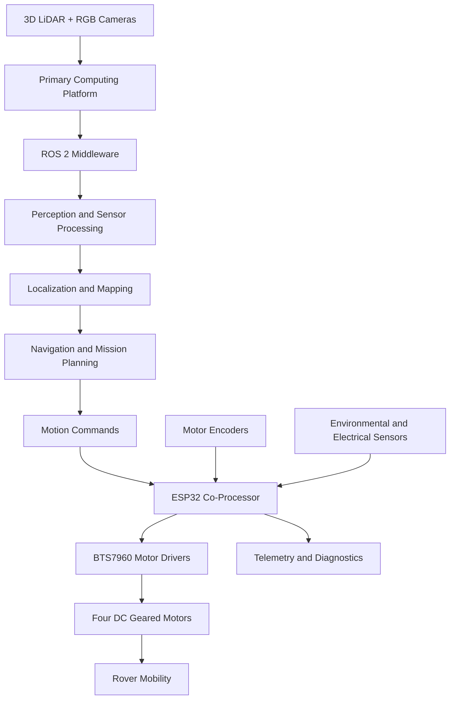

# 🌕 LUNABOT
### Autonomous Lunar Exploration Rover | Planetary Robotics | ROS 2 | Edge AI

<p align="center">
  <strong>An evolving autonomous robotic platform for research and experimentation in planetary exploration technologies.</strong>
</p>

<p align="center">
  <a href="https://github.com/Rehaan0745/Lunabot">
    
  </a>
  
  
  
  
</p>

---

## 1. Overview

**Lunabot** is an experimental four-wheel-drive (4WD) autonomous robotic platform developed to investigate technologies relevant to lunar and planetary surface exploration.

The project combines mechanical engineering, embedded systems, edge computing, computer vision, LiDAR-based perception and autonomous robotics within a modular development architecture.

The current prototype integrates:

- An aluminium 4WD robotic chassis.
- Compliant wheels and high-torque DC geared motors.
- Motor encoders and BTS7960 motor drivers.
- NVIDIA Jetson Orin Nano / Raspberry Pi 5 computing platform options.
- ESP32 embedded co-processor.
- 3D LiDAR-based spatial perception.
- Dual Logitech USB RGB cameras.
- Environmental and electrical telemetry sensors.
- ROS 2-based software development architecture.

Lunabot is designed as a continuously evolving engineering research platform. Its development roadmap extends from basic robotic mobility and autonomous navigation towards intelligent terrain assessment, fault-tolerant operation, environmental resilience and lunar-analogue experimentation.

**Important:** Lunabot is an Earth-based experimental prototype. It is not currently a flight-qualified lunar rover. Space-environment compatibility and flight qualification are long-term research objectives.

---

## 2. Project Vision

The long-term vision is to develop a modular autonomous rover capable of:

- Understanding unfamiliar terrain using multiple sensors.
- Building maps of unstructured environments.
- Localizing itself without dependence on GPS.
- Detecting obstacles and assessing terrain traversability.
- Planning and executing autonomous navigation missions.
- Monitoring its own electrical and operational health.
- Making safe decisions under communication interruptions.
- Supporting interchangeable scientific and experimental payloads.

The project follows a progressive engineering approach, with every development generation introducing measurable improvements in autonomy, reliability and environmental resilience.

---

## 3. Current Prototype – Lunabot Mk1

### Mechanical Platform

| Component | Specification |
|---|---|
| Chassis | Aluminium robotic chassis |
| Approximate dimensions | 300 × 250 mm |
| Drive configuration | Four-wheel drive |
| Wheels | 100–120 mm compliant wheels |
| Wheel hubs | Custom yellow structural hub plates |
| Actuators | 12 V high-torque DC geared motors |
| Feedback | Integrated motor encoders |
| Motor drivers | BTS7960 H-bridge drivers |
| Navigation structure | Elevated sensor mounting mast |

### Computing Architecture

| Component | Role |
|---|---|
| NVIDIA Jetson Orin Nano / Raspberry Pi 5 | Primary computing platform options |
| ESP32 | Embedded co-processor |
| USB / UART serial interface | Communication between computing layers |

The final deployed primary computing configuration and communication protocol are to be documented against the tested hardware revision.

### Perception and Navigation

| Component | Function |
|---|---|
| 3D LiDAR | Spatial perception and point-cloud acquisition |
| Logitech USB RGB Camera 1 | Elevated environmental observation |
| Logitech USB RGB Camera 2 | Additional visual monitoring |

### Environmental and Electrical Monitoring

| Sensor | Measurement |
|---|---|
| DHT11 | Temperature and humidity |
| BMP280 | Barometric pressure and temperature |
| LM393 | Ambient light sensing |
| ACS712 | Electrical current |
| DC0-25V module | Voltage measurement |
| LED perimeter panel | Visual status indication |

### Power System

- Main battery: 12 V, 12 Ah.
- Separate motor and computing power distribution is an area for continued electrical integration and validation.

---

## 4. System Architecture

Lunabot follows a distributed computing architecture that separates high-level robotic intelligence from low-level embedded control.



### High-Level Computing

The primary computing platform is intended to handle:

- ROS 2 communication.
- Camera processing.
- LiDAR point-cloud processing.
- Computer vision.
- SLAM and localization.
- Path planning.
- Autonomous navigation.
- Mission-level decision-making.

### Embedded Control

The ESP32 provides the embedded hardware interface for:

- Motor driver control.
- PWM signal generation.
- Encoder acquisition.
- Peripheral sensor acquisition.
- Telemetry collection.
- Serial communication with the primary computer.

This separation is intended to improve modularity and allow the navigation software to evolve independently of the embedded motor-control firmware.

---

## 5. Software Architecture

ROS 2 is the intended middleware framework for communication between the rover's software components.

The planned software modules include:

| Module | Responsibility |
|---|---|
| Hardware Interface | Sensor and embedded-controller communication |
| Perception | Camera and LiDAR processing |
| Localization | Rover position and orientation estimation |
| Mapping | Environmental map generation |
| Navigation | Path planning and obstacle avoidance |
| Motor Control | Motion command execution |
| Telemetry | Electrical and environmental monitoring |
| Mission Management | Autonomous task execution |

### Development Technologies

- ROS 2
- Python
- C++
- OpenCV
- Point Cloud Library (PCL)
- ESP32 firmware development
- PlatformIO / Arduino IDE

The exact ROS 2 distribution, library versions and tested dependencies should be maintained alongside each software release.

---

## 6. Repository Structure

The repository currently includes the following major development areas:

```text
Lunabot/
│
├── firmware/
│   └── Embedded firmware development
│
├── prtyp/
│   └── Prototype-related development files
│
├── src/
│   └── Robotics software source code
│
├── Pi_bash.sh
│
├── Repo-Layout.txt
│
├── lunabot_repository_structure_core_files.md
│
├── requirements.txt
│
└── readme.md
```

Refer to the repository's actual directory contents and accompanying layout documentation for the latest package-level organization.

---

## 7. Development Roadmap

Lunabot is being developed through multiple engineering generations.

### Mk1 – Experimental Prototype

**Current generation**

- Four-wheel robotic mobility.
- Aluminium chassis and compliant wheels.
- Embedded motor-control architecture.
- LiDAR and RGB camera integration.
- Environmental and electrical monitoring.
- ROS 2 software foundation.

### Mk2 – Intelligent Autonomous Rover

**Next development generation**

- LiDAR-based SLAM.
- Multi-sensor localization.
- Camera-based object detection.
- Terrain classification.
- Traversability estimation.
- Autonomous waypoint navigation.
- Dynamic obstacle avoidance.
- Closed-loop motor velocity control.
- Real-time telemetry and diagnostics.

**Primary objective:** Develop a research-grade autonomous rover capable of mapping and navigating unfamiliar test environments.

### Mk3 – Advanced Engineering Rover

**Future development**

- Improved drivetrain and mobility.
- Advanced wheel-terrain interaction.
- Modular scientific payload integration.
- Intelligent power management.
- Battery health monitoring.
- Thermal monitoring.
- Fault Detection, Isolation and Recovery (FDIR).
- Autonomous safe-mode operation.

### Mk4 – Lunar Analogue Rover

**Experimental research phase**

- Lunar regolith simulant experiments.
- Dust mitigation research.
- Thermal cycling.
- Vibration and endurance testing.
- Energy-aware navigation.
- Long-duration autonomous operation.
- Environmental protection.

### Mk5 – Space-Oriented Engineering Architecture

**Long-term research vision**

- Radiation-tolerant computing architectures.
- Space-qualified electronic components.
- Vacuum-compatible mechanical systems.
- Thermal-vacuum engineering.
- Radiation effects evaluation.
- Mission-specific flight software.
- Environmental qualification and verification.

These are proposed development objectives, not claims of existing capabilities or completed qualification.

---

## 8. Research and Future Enhancements

The following research areas are expected to guide future development.

### Autonomous Navigation

- SLAM and sensor fusion.
- Visual-LiDAR odometry.
- Obstacle detection.
- Terrain-aware path planning.
- Autonomous exploration.

### Intelligent Terrain Perception

- Rock and crater detection.
- Terrain segmentation.
- Slope estimation.
- Traversability scoring.
- Wheel-slip prediction.

### Power and Energy Management

- Battery State of Charge estimation.
- Battery State of Health monitoring.
- Power consumption analysis.
- Energy-aware path planning.
- Adaptive power management.

### Fault-Tolerant Robotics

- Sensor failure detection.
- Motor fault detection.
- Communication-loss handling.
- Watchdog systems.
- Autonomous recovery and safe modes.

### Planetary Environmental Engineering

- Thermal management.
- Lunar dust mitigation.
- Vacuum-compatible materials.
- Radiation-tolerant electronics.
- Regolith mobility studies.

---

## 9. Testing and Validation

Lunabot's development will follow a systematic testing strategy.

| Test | Objective |
|---|---|
| Mobility testing | Evaluate rover movement and terrain traversal |
| Motor testing | Validate motor response and encoder feedback |
| LiDAR testing | Evaluate spatial perception and mapping |
| Camera testing | Evaluate image acquisition and perception |
| Localization testing | Measure position and orientation accuracy |
| Navigation testing | Evaluate autonomous goal-reaching |
| Power testing | Characterize voltage, current and consumption |
| Endurance testing | Measure continuous operating duration |
| Fault testing | Evaluate fault detection and recovery |
| Environmental testing | Evaluate dust, thermal and vibration resilience |

Performance improvements will be documented using measured results rather than assumed capabilities.

---

## 10. Getting Started

### Prerequisites

The development environment depends on the selected primary computing platform.

Expected software requirements include:

- Ubuntu Linux.
- A compatible ROS 2 distribution.
- Python 3.
- C++ development tools.
- Git.
- Required ROS 2 and Python dependencies.

The exact tested versions and installation instructions will be maintained as the software setup is standardized.

### Clone the Repository

```bash
git clone https://github.com/Rehaan0745/Lunabot.git

cd Lunabot
```

### Inspect the Project

```bash
ls -la
```

Refer to `Repo-Layout.txt` and `lunabot_repository_structure_core_files.md` for repository organization.

### Software Setup

Install the dependencies specified by the relevant project modules.

```bash
python3 -m pip install -r requirements.txt
```

ROS 2 workspace build and launch instructions should be followed according to the actual package structure and the tested ROS 2 distribution.

**Note:** The project setup is evolving. Hardware-specific firmware flashing, sensor configuration and launch procedures will be documented as verified procedures become available.

---

## 11. Project Status

| Development area | Status |
|---|---|
| Mechanical rover prototype | Existing |
| Four-wheel drivetrain | Existing |
| Embedded electronics | Existing |
| LiDAR and RGB camera hardware | Existing |
| Environmental telemetry hardware | Existing |
| ROS 2 integration | Under development / verification |
| SLAM and mapping | Development objective |
| Autonomous navigation | Development objective |
| Terrain classification | Planned |
| Intelligent power management | Planned |
| Fault-tolerant operation | Planned |
| Lunar analogue testing | Future research |
| Flight-oriented qualification | Long-term vision |

The status of individual software features will be updated as implementation and testing progress.

---

## 12. Engineering Philosophy

Lunabot follows five core engineering principles:

1. **Modularity:** Hardware and software subsystems should be independently maintainable and replaceable.
2. **Autonomy:** Navigation and mission execution should progressively reduce dependence on continuous human intervention.
3. **Reliability:** Fault detection, monitoring and safe operation should be integral to system design.
4. **Scalability:** The architecture should support future sensors, computing platforms and scientific payloads.
5. **Validation:** Every major capability should be supported by measurable experimental results.

---

## 13. Contributing

Lunabot is an evolving engineering research project.

Contributions and technical discussions related to the following areas are welcome:

- Robotics and ROS 2.
- Embedded systems and firmware.
- Computer vision and AI.
- SLAM and autonomous navigation.
- Mechanical design and CAD.
- Sensor integration.
- Planetary robotics research.
- Testing and simulation.

For proposed contributions:

1. Review the existing repository structure.
2. Identify the relevant subsystem.
3. Create a separate development branch.
4. Implement and test the changes.
5. Document hardware and software dependencies.
6. Submit a pull request with a description of the changes and test results.

---

## 14. Long-Term Vision

Lunabot aims to evolve from an experimental four-wheel robotic prototype into a modular autonomous planetary exploration research platform.

The project focuses on developing and experimentally validating technologies that can contribute to future planetary robotics, including intelligent navigation, terrain understanding, autonomous decision-making, fault tolerance and environmental resilience.

The long-term goal is not simply to build a rover that resembles a lunar exploration vehicle, but to investigate the engineering principles and technologies required for reliable autonomous operation in challenging extraterrestrial environments.

---

## 15. Repository and Project Information

**Project:** Lunabot – Autonomous Lunar Exploration Rover  
**GitHub:** https://github.com/Rehaan0745/Lunabot  
**Development:** Experimental engineering and research platform  
**Primary domains:** Robotics, Embedded Systems, Edge AI, ROS 2 and Planetary Exploration

---

*Lunabot – Engineering the next generation of autonomous planetary exploration systems.*
